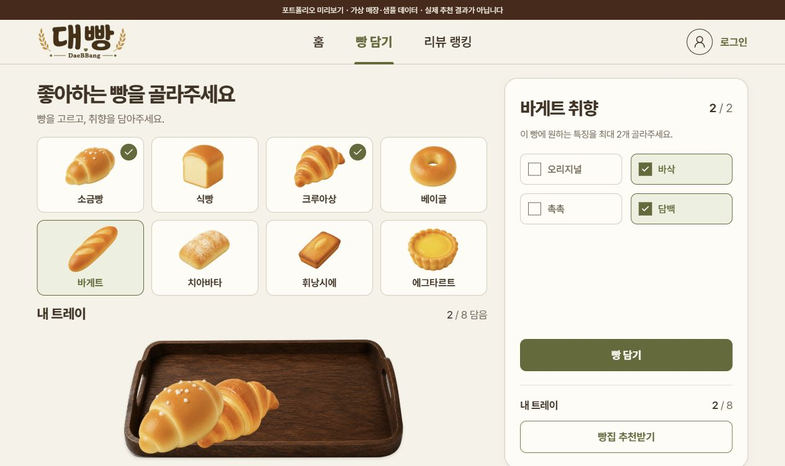
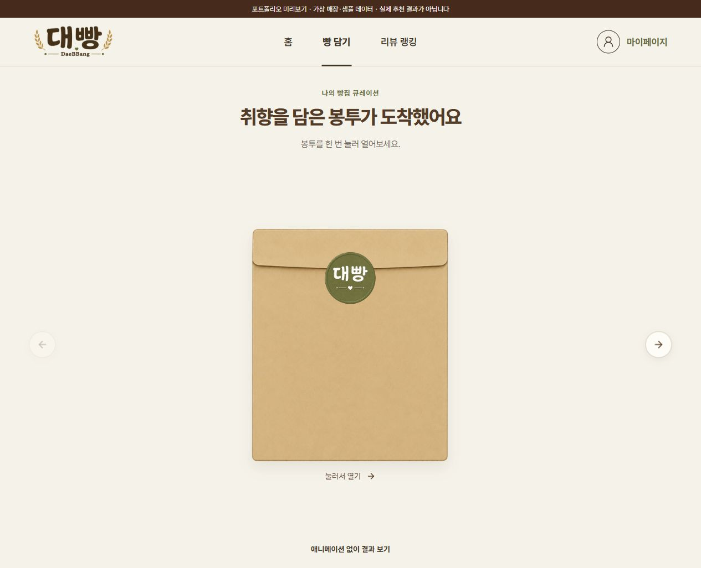
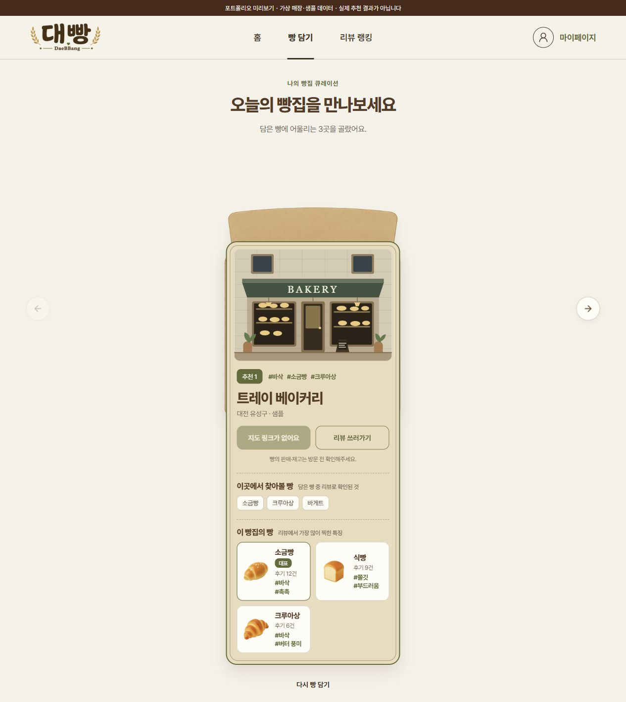
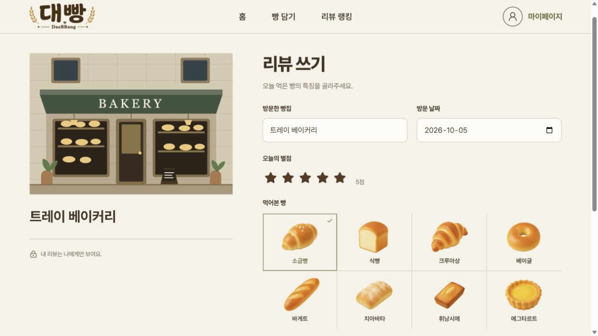
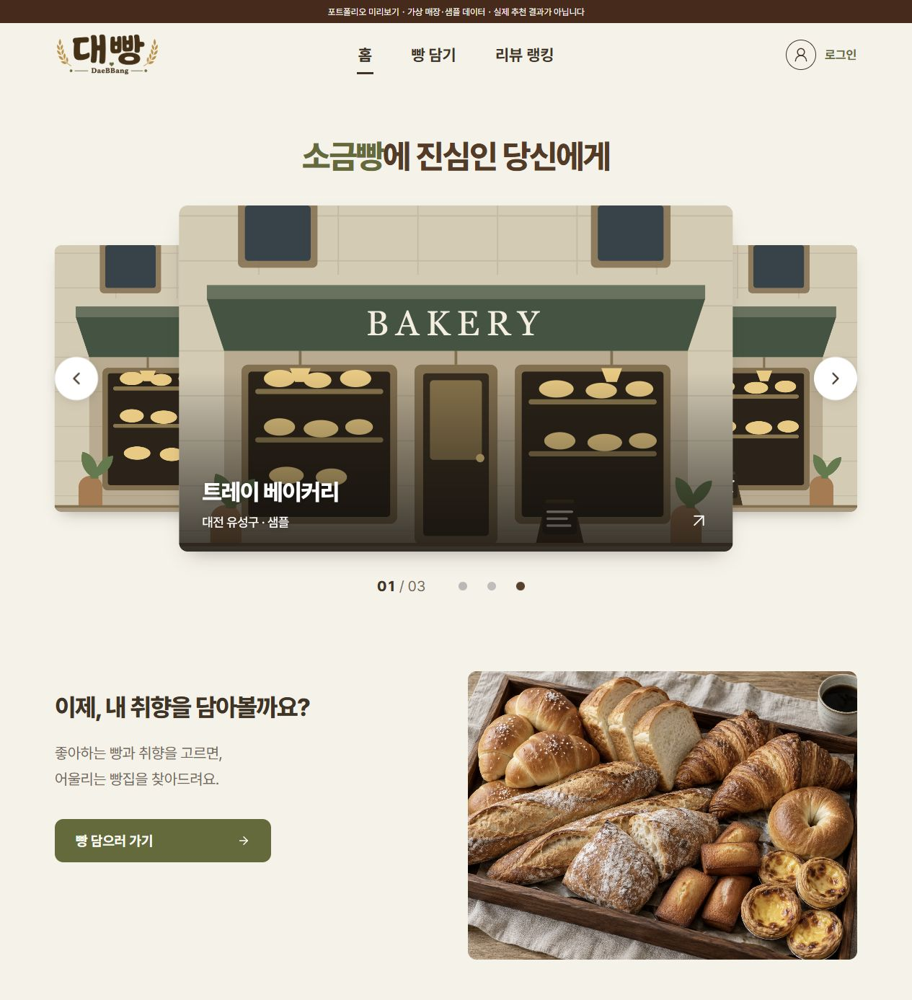
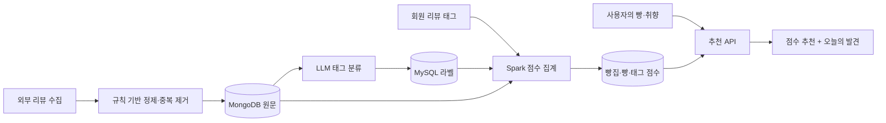

<p align="center">
  
</p>

<h1 align="center">취향을 담아 찾는 대전 빵집, 대빵</h1>

<p align="center">좋아하는 빵을 트레이에 담으면, 나의 빵집이 봉투에 담겨 도착합니다.</p>

<p align="center">
  <a href="#서비스-화면">서비스 화면</a> &nbsp;·&nbsp;
  <a href="#박민규의-기여">개인 기여</a> &nbsp;·&nbsp;
  <a href="#추천을-만드는-방법">추천 설계</a> &nbsp;·&nbsp;
  <a href="#로컬에서-둘러보기">직접 실행</a> &nbsp;·&nbsp;
  <a href="SOURCE_SNAPSHOT.md">공개 소스 안내</a>
</p>

<p align="center">SSAFY 15기 특화 프로젝트 · 빅데이터 분산 · 팀 B207 · 2026.08–10</p>

<p align="center">
  <code>React</code> &nbsp;·&nbsp; <code>Spring Boot</code> &nbsp;·&nbsp;
  <code>Apache Spark</code> &nbsp;·&nbsp; <code>LLM Classification</code>
</p>

> 대빵은 빵의 종류와 맛·식감 취향을 바탕으로 대전의 빵집을 추천하는 팀 프로젝트입니다. 이 저장소는 서비스 화면과 구현을 검토할 수 있도록 정리한 공개 포트폴리오 스냅샷입니다.

| 구분 | 내용 |
| --- | --- |
| 사용자 경험 | 빵 선택 → 취향 태그 → 추천 봉투 → 빵집 확인 → 방문 리뷰 |
| 추천 입력 | 빵 8종 중 최대 8종, 빵마다 취향 태그 최대 2개 |
| 추천 구성 | 점수 기반 최대 2곳 + 탐색을 위한 ‘오늘의 발견’ 슬롯 |
| 기술적 초점 | LLM 분류와 점수 계산 분리, 리뷰 기반 집계, 온라인·배치 경로 분리 |
| 개인 참여 | 박민규 · 서비스 기획, 데이터 파이프라인·점수 로직 검토, 발표 자료 구성 |
| 검증 | 공개 스냅샷 프론트엔드 테스트 **124개 통과**, 프로덕션 빌드 통과 |
| 공개 범위 | 서비스 소스·스키마·로컬 UI 미리보기·화면 캡처·설계 설명 |

## 문제

같은 빵을 좋아해도 원하는 식감은 다릅니다. ‘소금빵 맛집’이라는 검색어만으로는 바삭한 겉면을 원하는 사람과 촉촉한 속을 원하는 사람의 취향을 구분하기 어렵습니다. 유명한 빵집에 리뷰가 집중되면 후기 수가 적은 가게를 발견하기도 어렵습니다.

대빵은 **가게 이름보다 먹고 싶은 빵과 취향을 먼저 묻습니다.** 리뷰에서 추출한 특징을 공통 태그로 연결하고, 점수 기반 추천과 새로운 가게를 탐색하는 슬롯을 함께 제공합니다.

## 박민규의 기여

**서비스 기획과 기술 검토, 발표 자료 구성에 참여했습니다.**

- 빵 종류와 세부 취향 태그로 탐색하는 흐름, 리뷰 참여를 유도하는 랭킹·칭호 방안을 구체화했습니다.
- 리뷰 수집·정제·저장·LLM 분류·Spark 집계의 역할을 검토하고, LLM 사용 방식과 저장소 대안을 비교했습니다.
- 리뷰가 적거나 오래됐을 때의 점수 보정과 외부·회원 리뷰 결합 방식을 검토했습니다. 이를 비전공자도 이해할 수 있도록 사례와 파이프라인 중심의 발표 자료로 정리했습니다.

아래 서비스 코드와 화면은 팀 산출물입니다. 개인 기획·검토 범위와 관련 구현 위치는 [기여 범위](docs/contribution.md)에 구분했습니다.

## 서비스 화면

아래 이미지는 공개된 React 소스를 로컬에서 실행하고 직접 조작해 캡처한 화면입니다. 매장·계정·리뷰 집계 수치는 **가상의 미리보기 데이터**이며, 실사용자의 정보나 실제 추천 성능을 나타내지 않습니다. 수집한 매장 사진은 제외하고 프로젝트의 일러스트로 대체했습니다.

### 01. 취향 선택 — 빵을 골라 나만의 트레이에

소금빵, 크루아상, 바게트 등 8종의 빵을 고르고 빵마다 원하는 특징을 최대 2개 선택합니다. 선택한 빵은 트레이 위에 쌓이고, 아직 담지 않은 빵의 취향을 이어서 조정할 수 있습니다.

<p align="center"></p>

### 02. 추천 봉투 — 결과를 꺼내 보는 경험

추천 결과는 봉투를 열어 확인합니다. 처음 열 때만 개봉 애니메이션을 실행하고, 이미 확인한 결과로 돌아오면 즉시 내용을 보여줍니다. 애니메이션을 건너뛰는 경로도 제공합니다.

<p align="center"></p>

### 03. 빵집 확인 — 이름과 함께 추천 근거를

사용자가 담은 빵 중 리뷰로 확인된 빵과 자주 언급된 특징을 함께 보여줍니다. 점수가 없는 탐색 슬롯은 ‘오늘의 발견’으로 구분합니다. 리뷰 근거는 실제 재고·판매 여부를 보장하지 않으므로 방문 전 확인하도록 안내합니다.

<p align="center"></p>

### 04. 방문 리뷰 — 다음 추천에 연결될 취향 기록

방문 날짜·별점·먹어본 빵·특징 태그를 기록합니다. 리뷰 내용은 작성자만 조회하고, 추천에는 집계된 태그 정보를 사용하도록 설계했습니다. 공개 미리보기는 입력 화면까지만 제공하며 실제 리뷰를 저장하지 않습니다.

<p align="center"></p>

<details>
<summary>홈 화면 보기</summary>

오늘의 빵집을 둘러보고 ‘빵 담으러 가기’로 취향 선택을 시작합니다. 홈 큐레이션과 개인 취향 추천은 별개의 기능입니다.



</details>

## 추천을 만드는 방법



| 결정 | 구현 | 이유 |
| --- | --- | --- |
| LLM은 태그 분류에만 사용 | 리뷰가 언급한 특징을 태그 사전의 값으로 제한 | 분류의 불확실성과 점수 계산을 분리 |
| 온라인 요청에서 LLM 제외 | API가 Spark 집계 테이블을 조회 | 추천을 요청할 때마다 수집·추론을 기다리지 않도록 구성 |
| 적은 표본을 평균 쪽으로 보정 | m-추정과 반감기 180일의 시간 가중 적용 | 리뷰 1건의 결과가 극단적인 순위로 이어지는 현상 완화 |
| 데이터가 있는 빵끼리 평균 | 선택한 빵의 절반 이상에 근거가 있어야 점수 후보 | 결측을 무조건 0으로 처리하거나 리뷰가 많은 가게를 합산으로 우대하지 않음 |
| 탐색 슬롯을 별도로 제공 | 영업 중이며 이미 선정되지 않은 가게에서 무작위 선택 | 점수가 부족한 가게에도 노출 기회 제공 |

점수 공식과 코드 위치는 [아키텍처·추천 설계](docs/architecture.md)에 정리했습니다. 이 설계의 효과를 정확도·전환율 향상으로 단정하지 않으며, 공개 자료에 없는 성능 수치는 제시하지 않습니다.

## 데이터가 없을 때의 추천

팀의 문제 분석 기록에서는 추천 **47회 중 7회**가 빈 결과였고, 당시 등록 빵집 **106곳 중 59곳**만 점수 데이터를 보유했습니다. 희소한 태그를 고르면 후보가 없었고, 데이터가 없는 빵집은 계속 추천에서 빠졌습니다.

해결은 점수 기반 추천 최대 2곳에 **‘오늘의 발견’ 1곳**을 더하고, 점수 후보가 부족하면 남은 자리를 탐색 슬롯으로 채우는 방식이었습니다. 탐색 대상은 점수가 전혀 없는 가게로 한정하지 않고, 영업 중인 미선정 가게 전체에서 고릅니다.

이 수치는 **당시 팀 문서에 기록된 관측값**입니다. 공개 미리보기의 합성 데이터로 재측정한 결과가 아니며, 변경 후 추천 품질·리뷰 유입 증가를 입증하는 지표도 아닙니다. 서로 다른 영업 중 가게가 3곳 미만이면 결과는 3곳보다 적을 수 있습니다.

[문제·대안·검증 범위 자세히 보기](docs/recommendation-case.md)

## 구현 살펴보기

| 읽을 코드 | 확인할 내용 |
| --- | --- |
| [RecommendationService](backend/api/src/main/java/com/bangtray/api/recommendation/RecommendationService.java) | 후보 커버리지, 평균 점수, 탐색 슬롯, 추천 기록 |
| [ScoreAggregationJob](backend/spark/src/main/java/com/bangtray/spark/ScoreAggregationJob.java) | 시간 가중, m-추정, 내부·외부 리뷰 결합, 전체 결과 교체 |
| [LabelingService](backend/batch/src/main/java/com/bangtray/batch/label/LabelingService.java) | 태그 사전 검증, 중복 라벨 방지, 처리 완료 표시 |
| [API client](frontend/src/lib/api/client.mjs) | 토큰 갱신, 한 번의 재요청, 계정 변경 중 응답 처리 |
| [TrayPage](frontend/src/features/tray/TrayPage.jsx) · [봉투 상태](frontend/src/features/service/bag-state.mjs) | 빵 선택·취향 입력과 개봉 인터랙션 |

## 기술 스택

| 영역 | 사용 기술 |
| --- | --- |
| Frontend | React 19, Vite 8, Radix UI, Node.js 24, pnpm 11 |
| Backend | Java 21, Spring Boot 4.1, Spring Security, Spring Data JPA |
| Batch & Data | Spring Batch, Apache Spark 3.5.4, Python, FastAPI |
| Storage | MySQL 8, MongoDB 7 |
| AI | LLM API 기반 리뷰 태그 분류 |
| 팀 운영 구성 | Docker, Nginx, GitLab CI/CD, EC2 — 운영 설정은 공개 제외 |

운영 MongoDB의 단일 멤버 관측과 로컬 3노드 실습 구성은 구분합니다. Spark 엔진을 사용했다는 사실을 여러 물리 서버에서의 처리 성능 검증으로 표현하지 않습니다.

## 로컬에서 둘러보기

Node.js 24와 pnpm 11.19.0을 준비하고 저장소 루트에서 실행합니다.

```bash
cd frontend
pnpm install --frozen-lockfile
pnpm test
pnpm demo
```

브라우저에서 `http://127.0.0.1:5173`을 엽니다. 추천 흐름을 보려면 **미리보기 전용 가상 계정** `demo@example.test` / `portfolio-demo`로 로그인합니다. 이는 로컬 화면 확인용 고정 문자열이며 어떤 실제 서비스에서도 사용할 수 없습니다.

- 빵 선택 → 태그 선택 → 트레이 담기 → 추천 요청 → 봉투 개봉 → 리뷰 입력까지 확인할 수 있습니다.
- `pnpm demo`는 실제 UI에 정해진 합성 API 응답을 연결합니다. Spring 서버·DB·LLM을 실행하거나 실제 추천을 계산하지 않습니다.
- 리뷰 저장·회원가입·랭킹은 미리보기 API에서 제공하지 않습니다. 데이터는 파일이나 외부 서버에 저장하지 않습니다.
- `pnpm dev`는 별도의 로컬 백엔드(`http://localhost:8080`)에 연결합니다. Google 로그인은 본인의 클라이언트 ID를 설정한 경우에만 표시됩니다.
- `pnpm build`는 실제 제품 프론트엔드를 빌드합니다. 미리보기 API와 안내 배너는 제품 번들에 들어가지 않습니다.

## 검증과 공개 범위

2026-10-05, Node.js 24 환경에서 공개 스냅샷의 프론트엔드 **124개 테스트와 빌드**를 확인했습니다. 기존 123개 테스트에 미리보기 데이터가 실제 UI 어댑터와 맞는지 확인하는 검사 1개를 추가했습니다. 커밋별 결과는 [Frontend checks](https://github.com/scnelMG/daebbang-portfolio/actions/workflows/frontend-checks.yml)에서 확인할 수 있습니다.

실제 Google 인증, 운영 DB, LLM 추론, Spark 실행과 추천 품질은 이번 공개본 검증에 포함하지 않았습니다. backend·batch·spark의 자동 테스트 보강은 남은 과제입니다.

[검증 근거](docs/verification.md) · [공개 제외 항목](SOURCE_SNAPSHOT.md) · [이미지 안내](assets/README.md)

## 팀과 출처

대빵은 **SSAFY 15기 B207 팀이 함께 만든 프로젝트**입니다. 이 저장소는 박민규의 포트폴리오에서 팀 프로젝트를 소개하는 공개 사본입니다. 팀 전체 구현을 개인 단독 성과로 주장하지 않으며, 원본의 기여자 권리는 유지됩니다.

원본 GitLab 저장소와 이력은 변경하지 않았습니다. 공개본에는 민감 자료가 들어 있는 과거 이력을 가져오지 않고, 검토한 코드 스냅샷으로 새 이력을 시작했습니다. 공개본 정리 과정의 변경은 [SOURCE_SNAPSHOT.md](SOURCE_SNAPSHOT.md)에 기록했습니다.

## 이용 안내

기존 포트폴리오 저장소와 같은 [Portfolio Reference License](LICENSE)를 적용합니다. 포트폴리오·학습 기록 열람을 위한 공개이며, 코드·문서·이미지의 재사용·수정·배포는 사전 문의가 필요합니다. 제3자 자료에는 해당 자료의 원래 조건이 우선합니다.
